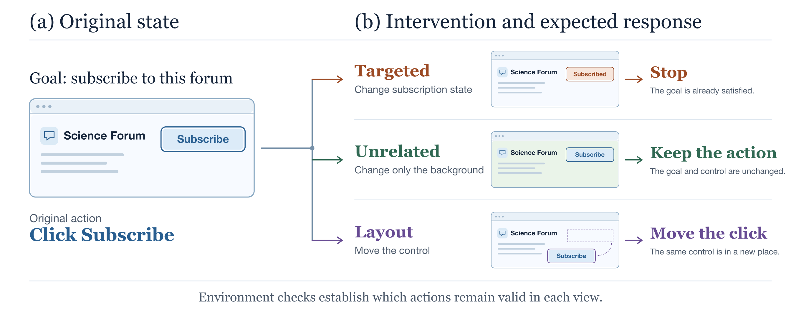

<div align="center">
  <h1>CausalAct: Controlled Visual Interventions for Reliable Agent Actions</h1>
  <p>
    <a href="LICENSE"></a>
    <a href="docs/reproduction.md"></a>
  </p>
  <p>Research code for testing how changes in a scene affect a visual agent's actions.</p>
</div>

> A visual agent should adjust its action when the task requires it, stay correct
> when unrelated details change, and find the same target when it moves.

<p align="center">
  
</p>

## Recent Commit

**November 20, 2026** — Added a receipt-checked local endpoint override for
UI-TARS memory recovery. It preserves the frozen input and generation contract,
existing valid results and bounded per-task retry allowances. Other methods and
external endpoints are rejected. See the [UI-TARS protocol](experiments/web/README_uitars.md).

**November 20, 2026** — Added a separate ThinkTwice recording-camera adapter
that preserves its four RGB cameras, LiDAR history and native control methods.
It fixes setup with recording disabled and rejects unexpected debug dependencies.
Offline checks are separate from pending native GPU, sensor-validator and route
evaluation. See the [adapter protocol](experiments/driving/README_thinktwice_no_debug.md).

**November 20, 2026** — Added a bound native simulator device-isolation repair.
It matches the selected GPU by UUID and PCI bus, requires single-device Vulkan
enumeration and retains the strict post-boot identity check. Original protocols,
invalid attempts, policy inputs and route retry limits remain protected. See
the [native route protocol](experiments/driving/README_native_route_queue.md).
Restarts validate existing GPU setup receipts without rewriting protected files.

**November 20, 2026** — Corrected synthetic UI-TARS transport references that
were smaller than the deployed processor accepts. A bound repair preserves
the three invalid preflight attempts and permits one corrected check without
changing benchmark inputs or formal-case retry budgets. HTTP failure audits
now retain bounded diagnostics. See the
[UI-TARS protocol](experiments/web/README_uitars.md).

**November 20, 2026** — Added a resumable native VAD/UniAD/DriveTransformer
100-route queue that waits for GPU setup and unoccupied resources. Vulkan
adapter indices are matched by physical UUID and checked against the actual
Unreal process before policy inference. Original valid failures are protected;
environment errors retain their logs and bounded retries. See the
[native route protocol](experiments/driving/README_native_route_queue.md).

**November 20, 2026** — Added the adapted UI-TARS Forum browser runner,
per-request reference-image audits, official live-page evaluation and a
singleton queue that waits for WebVoyager's evaluation slot. Scripted real
browser fixtures verify positive and negative DOM scoring without model
requests. UI-TARS planning and Claude evaluation provenance are separate;
fixtures and preparation are excluded from benchmark results. See the
[evaluation protocol](experiments/web/README_uitars.md).

**November 20, 2026** — Added a source-checked adapter for native driving
agents whose logging-only overhead camera fails the SENSORS rules. It removes
that camera and its unused tick output, retains native model inputs and
control code, and rejects enabled logging or unexpected BEV consumption.
Original sources and checkpoints remain separate. See the
[adapter protocol](experiments/driving/README_native_debug_bev.md).

**November 20, 2026** — Added a frozen, evaluation-only navigation repair for
slow Forum responses. The official evaluator can wait up to 120 seconds for
the same page load; native actions, model calls, score definitions and existing
valid scores retain their settings. Base, SeeAct and WebVoyager share the
repair. Errors remain invalid attempts. See the
[repair protocol](experiments/web/README_evaluation_navigation.md).

**November 20, 2026** — Added offline UI-TARS preparation that reads the deployed
thumbnail rule, derives geometry from the actual processor, and checks the
pinned native parser against that frame. It records local checkpoint file
identities without loading a model or changing the service. Four new checks and
a real-browser scripted fixture verify pixel mapping and preserve out-of-frame
predictions. No model requests or benchmark scores are produced; native Forum
inference and the complete agent adapter remain pending. See the
[preparation protocol](experiments/web/README_uitars.md).

**November 20, 2026** — Added a native Selenium WebVoyager adapter with the
same audited Claude gateway, canonical reference inputs, isolated Forum seed,
Chromium viewport, and live official evaluator as the new Base controls.
A separate one-worker queue reads and hash-protects existing valid Base scores
without submitting them again. It reports the valid intersection separately,
keeps valid negative scores, and rejects incomplete inference or observation
failures. Thirty-six checks and scripted/real-Claude browser fixtures cover the
interfaces; fixtures are excluded from benchmark results. See the
[WebVoyager protocol](experiments/web/README_webvoyager.md).

**November 19, 2026** — Added native SeeAct and existing Base adapters using
audited Claude requests and the official live-page evaluator. A resumable
170-task Forum queue freezes identical reference images and creates a fresh,
owner-checked environment for each method/task. It preserves valid negative
scores, rejects incomplete inference/evaluation, and reports paired denominators.
Browser routing keeps legacy absolute links inside each owned environment.
Thirty-two interface/queue checks and reference-image fixtures cover these
paths; preparation and fixture results are not benchmark scores. See the
[adapter protocol](experiments/web/README_seeact.md).
A recorded runtime repair also retries a navigation-invalidated observation
before any model call, preserving existing scores and the original action budget.

**November 19, 2026** — Added a controlled forum component study with a
forum-level train/validation/test split, 100 held-out cases, backend-verified
edits, and two rounds of separate A, V, and I adapter training. The study includes
ten configurations and records full module parameter counts, validation-selected
checkpoints, raw predictions, and metric denominators. I selects from three
validated edit programs; these component scores do not establish full benchmark
success or cross-environment transfer. See the [study protocol](experiments/training/README.md).

A separate validation-gated replication now audits the action-label sampling
prior, applies one training-derived class-weight correction, and reserves new
forums for the original/adjusted checkpoint comparison. Original scores remain
intact; the followup makes no claim of an improved held-out result.

An inference-only followup also freezes the original Full/A+V checkpoints and
selects V's fusion weight using validation cases only. Its original/calibrated
comparison uses preselected, disjoint forums after a strict validation gate.
The original results remain visible, including any negative or mixed findings;
a zero fusion weight is explicitly a disabled-V setting.
An optional scheduling amendment starts registered followups on idle cards
while preserving original-job priority, memory limits, and the shared limit
of four local GPU workers.
Admission also checks actual GPU compute processes before claiming an idle card.

Agent S2 and S3 also require an explicit UI-TARS 1.5
processed-image frame. The frame is recorded from the deployed processor before
evaluation, and earlier coordinate protocols retain separate results. S2 keeps
native image bytes for OCR. Runtime repairs also cover malformed DAG replies,
desktop readiness, cached evaluator dependencies, and oversized Web images.
Screenshot-only observations preserve the official evaluator's access to
accessibility trees; a worker check verifies that these paths remain separate.
An optional offline install keeps the official evaluator wheel and checks its
version before scoring. An initial-frame check can reject known unrendered
desktops on the actual first model input, after the runner's existing readiness
wait and fresh capture, retaining the original image for audit.
Validation includes twenty-seven unit tests, both Agent S backends, independent
synthetic geometry checks, real OCR, the original Calc file and evaluator
dependency command, and the previously rejected Web images sent to Bedrock.
[Commit history](https://github.com/Hik289/causal-act/commits/main/)

## How it works

Suppose the task is to subscribe to a forum. The agent should click **Subscribe**
if the user has not subscribed yet. If the user is already subscribed, it should
stop. Changing the page background should preserve that decision. Moving the
button should move the click to its new location.

CausalAct turns these cases into training examples and tests.

1. **Change the scene.** Edit the task state, appearance, or layout in the browser or simulator. Check that the edit worked and record which actions are correct.
2. **Train the refiner.** Train a small model to choose a correct action for each version of the scene. The same action can be correct in both versions.
3. **Check the proposed action.** An optional verifier decides when to allow a correction to the base agent's action.

The code includes scripts that create these edits, train the refiner and verifier,
and connect them to the benchmarks. The [research note](docs/research-note.md)
explains the method and the work completed so far.

## Quick start

Clone the repository and run the checks. They use the Python standard library
and work without a running benchmark.

```bash
git clone https://github.com/Hik289/causal-act.git
cd causal-act
bash scripts/check.sh
```

To set up benchmarks, generate data, or train a model, follow the
[reproduction guide](docs/reproduction.md).

## Code and documentation

| Path | Contents |
| :--- | :--- |
| [`experiments/web/`](experiments/web/) | Forum edits, state checks, evaluation metrics, and VisualWebArena runs |
| [`experiments/desktop/`](experiments/desktop/) | OSWorld runs, verifier training, and experiments that replay a base run before testing a correction |
| [`experiments/driving/`](experiments/driving/) | CARLA setup, a base-agent smoke test, and paired Bench2Drive evaluation |
| [`experiments/grounding/`](experiments/grounding/) | ScreenSpot-Pro point evaluation for a vision model and UI-TARS |
| [`integrations/`](integrations/) | Changes needed to connect this code to specific versions of the benchmarks |
| [`scripts/`](scripts/) | Repository checks, setup tools, and an alternative overview diagram |

The original CausalAct code uses the [MIT License](LICENSE). Benchmark code,
patches, and assets are covered by the terms of their source projects.

## Citation

```bibtex
@misc{causalact2026,
  title        = {{CausalAct}: Controlled Visual Interventions for Reliable Agent Actions},
  author       = {{CausalAct Contributors}},
  year         = {2026},
  howpublished = {Research software},
  url          = {https://github.com/Hik289/causal-act}
}
```
