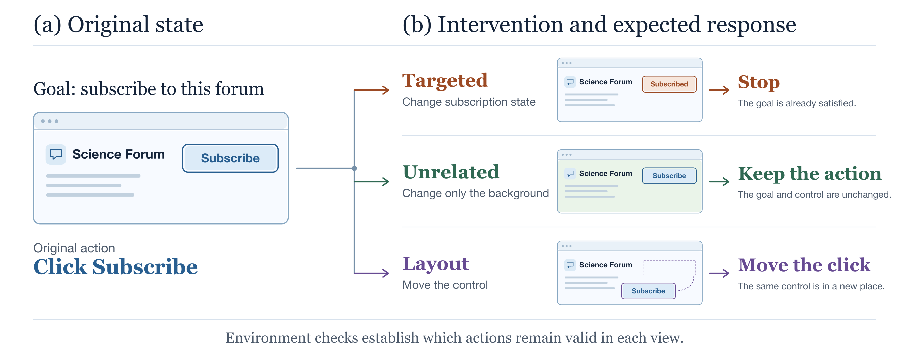

<div align="center">
  <h1>CausalAct: Controlled Visual Interventions for Reliable Agent Actions</h1>
  <p>
    <a href="LICENSE"></a>
    <a href="docs/reproduction.md"></a>
  </p>
  <p>Research code for testing how changes in a scene affect a visual agent's actions.</p>
</div>

> A visual agent should adjust its action when the task requires it, stay correct
> when unrelated details change, and find the same target when it moves.

<p align="center">
  
</p>

## How it works

Suppose the task is to subscribe to a forum. The agent should click **Subscribe**
if the user has not subscribed yet. If the user is already subscribed, it should
stop. Changing the page background should preserve that decision. Moving the
button should move the click to its new location.

CausalAct turns these cases into training examples and tests.

1. **Change the scene.** Edit the task state, appearance, or layout in the browser or simulator. Check that the edit worked and record which actions are correct.
2. **Train the refiner.** Train a small model to choose a correct action for each version of the scene. The same action can be correct in both versions.
3. **Check the proposed action.** An optional verifier decides when to allow a correction to the base agent's action.

The code includes scripts that create these edits, train the refiner and verifier,
and connect them to the benchmarks. The [research note](docs/research-note.md)
explains the method and the work completed so far.

## Quick start

Clone the repository and run the checks. They use the Python standard library
and work without a running benchmark.

```bash
git clone https://github.com/Hik289/causal-act.git
cd causal-act
bash scripts/check.sh
```

To set up benchmarks, generate data, or train a model, follow the
[reproduction guide](docs/reproduction.md).

## Code and documentation

| Path | Contents |
| :--- | :--- |
| [`experiments/web/`](experiments/web/) | Forum edits, state checks, evaluation metrics, and VisualWebArena runs |
| [`experiments/desktop/`](experiments/desktop/) | OSWorld runs, verifier training, and experiments that replay a base run before testing a correction |
| [`experiments/driving/`](experiments/driving/) | CARLA setup, test routes, and a short run that checks whether the base driving agent works |
| [`integrations/`](integrations/) | Changes needed to connect this code to specific versions of the benchmarks |
| [`scripts/`](scripts/) | Repository checks, setup tools, and an alternative overview diagram |

The original CausalAct code uses the [MIT License](LICENSE). Benchmark code,
patches, and assets are covered by the terms of their source projects.

## Citation

```bibtex
@misc{causalact2026,
  title        = {{CausalAct}: Controlled Visual Interventions for Reliable Agent Actions},
  author       = {{CausalAct Contributors}},
  year         = {2026},
  howpublished = {Research software},
  url          = {https://github.com/Hik289/causal-act}
}
```
